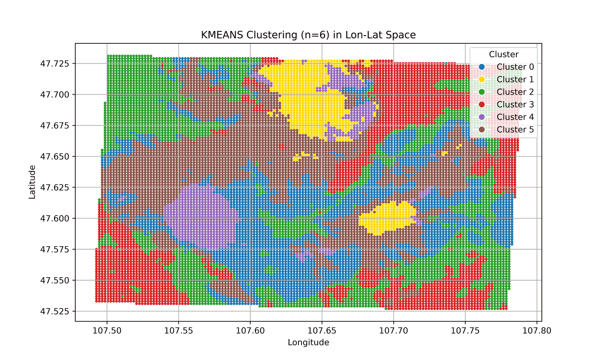
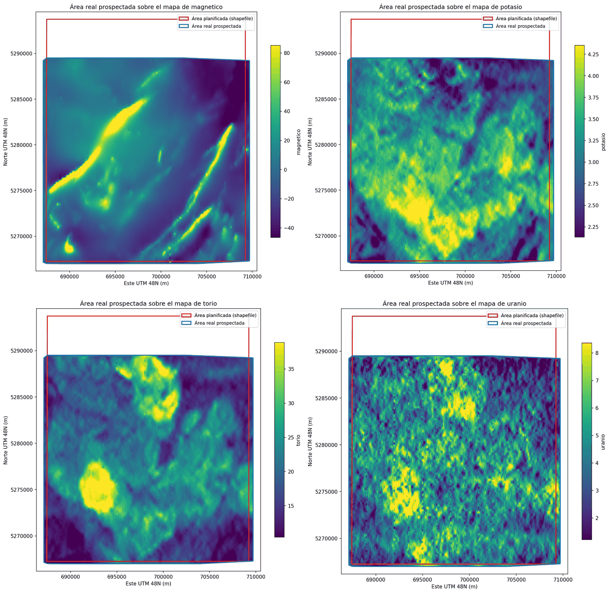
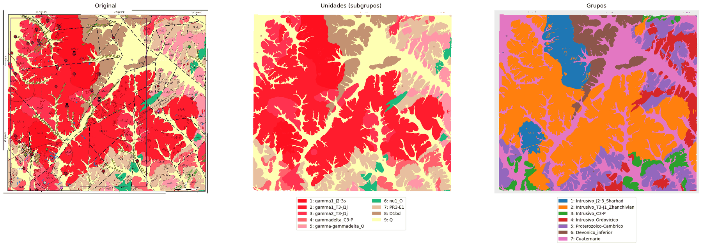

# Proyecto ML Mongolia

Procesamiento de datos y clustering como aplicacion Python (PEP 621)

## Resultados

Ejemplos de lo que genera el proyecto para una zona de Mongolia (los comandos están más abajo).

### Clustering

K-Means con 6 clusters sobre elevación (DEM), magnético, potasio, torio y uranio.



### Datos magnéticos y radiométricos

Magnético, potasio, torio y uranio sobre la zona realmente prospectada (azul). En rojo, el área de investigación planificada, que llegaba más al norte de lo que finalmente se midió.



### Geología

Mapa geológico original, clasificado en 9 unidades (subgrupos) y 7 grupos.



## Uso

Procesar datos

```bash
clustering-mongolia process-data
```

Clusterizar

```bash
clustering-mongolia create-cluster \
  --features DEM \
  --features Mag_Final \
  --features RTP \
  --features AS \
  --features TDR \
  --features Pot_final \
  --features Tho_Final \
  --features Ura_Final

```

## Cómo está organizado

El proyecto tiene un **pipeline principal** y, aparte, una **rama de geología**. Cada etapa deja sus resultados como **capas GIS** que se pueden abrir en QGIS y sumar a un proyecto.

```
Pipeline principal
  datos crudos (CSV) ──► process-data ──► create-cluster
                              │                 │
                              │                 └─► capas: clusters (shapefiles)
                              └─► capas: magnético y radiométricas (GeoTIFF)

Rama de geología (independiente del clustering)
  mapa geológico ──► extract-palette (una vez) ──► classify-geology
                                                        │
                                                        └─► capas: geología por clase

Control del área de investigación (usa lo de arriba)
  investigation-area ──► capas: área real, área planificada + mapas PNG de control
```

## Comandos: qué hace y qué genera cada uno

Todas las salidas van a `data/processed/` (salvo `create-cluster`, que va a `output/`). Las carpetas `data/` y `output/` no se versionan en git. Los parámetros están en `config/default.yml` y se pueden cambiar por opción de línea de comandos (ver `clustering-mongolia <comando> --help`).

### Pipeline principal

#### `process-data`

Carga los CSV crudos de `data/raw/` (DEM, magnético, potasio, torio, uranio), los regulariza en una grilla, deriva variables magnéticas (RTP, AS, TDR) y normaliza.

Genera:

| Qué | Dónde |
|---|---|
| CSV con todas las variables normalizadas (entrada del clustering) | `data/processed/normalized_data/` |
| Gráficos de cada variable normalizada y matriz de correlación | `data/processed/normalized_data/plots/` y `correlation_matrix.png` |
| CSV y gráficos de cada variable interpolada en la grilla | `data/processed/regularization/` |
| DEM con resolución reducida | `data/processed/created_from_DEM/` |
| **Capas GIS:** rasters GeoTIFF `magnetico`, `potasio`, `torio`, `uranio` (UTM 48N, 50 m) | `data/processed/geophysics/` |
| Log | `data/processed/process.log` |

#### `create-cluster`

Necesita: `process-data`. Calcula el número de clusters con el método del codo, corre el algoritmo elegido (K-Means por defecto) sobre las variables indicadas en `features` y grafica los resultados. Cada corrida crea su propia carpeta con fecha y hora.

Genera en `output/AAAA_MM_DD_HH_MM_SS/`:

| Qué | Dónde |
|---|---|
| Gráfico del codo | `clustering_results/elbow/` |
| Mapas geográficos de los clusters | `clustering_results/cluster_maps/` |
| Firmas geofísicas de cada cluster | `clustering_results/geophysical_signatures/` |
| **Capas GIS** de los clusters (lon/lat WGS 84), con estilo `.qml` y los mismos colores del mapa PNG: `clusters_polygons.shp` (un polígono por cluster), `by_cluster/cluster_<k>.shp` (un shapefile por cluster, de un solo color) y `clusters.shp` (la nube de puntos, con el campo `Cluster`) | `clustering_results/shapefiles/` |
| Log | `workflow.log` |

### Rama de geología (independiente del clustering)

#### `extract-palette` (solo la primera vez)

Lee `data/raw/geological_map.tif`, cuenta los colores y propone una paleta candidata. No sobrescribe una paleta existente salvo con `--force`.

Genera:

| Qué | Dónde |
|---|---|
| Paleta candidata, que se **edita a mano** para nombrar unidades y agruparlas | `config/geology_palette.yml` |
| Imagen con una muestra de cada color y dónde aparece en el mapa | `data/processed/geology/palette_swatches.png` |

#### `classify-geology`

Necesita: la paleta editada (`config/geology_palette.yml`) y el shapefile del área planificada (`data/raw/investigacion area/`). Clasifica cada píxel del mapa en una subclase (unidad) y un grupo.

Además **georreferencia** el mapa: la que trae el TIF no coincide con los datos, así que se recalcula haciendo coincidir el recuadro violeta del mapa con el polígono del área planificada.

Genera en `data/processed/geology/`:

| Qué | Dónde |
|---|---|
| **Capas GIS:** polígonos de subclases y de grupos, con estilo por clase (`.qml`) para prender y apagar cada clase en QGIS | `vectors/unidades.shp`, `vectors/grupos.shp` |
| **Capa GIS:** mapa geológico original ya georreferenciado | `geological_map_georef.tif` |
| Rasters de la clasificación (una banda con el id de cada clase) | `geology_units.tif`, `geology_groups.tif` |
| Una máscara 0/1 por subclase y por grupo | `masks_units/`, `masks_groups/` |
| Área y porcentaje de cada clase | `class_areas.csv` |
| Imagen de control: mapa original, unidades y grupos lado a lado | `control_visual.png` |
| Log | `classify_geology.log` |

### Control del área de investigación

#### `investigation-area`

Necesita: `process-data` y `classify-geology`. Compara el área planificada (shapefile) con la realmente prospectada, que es la huella de los datos magnéticos y termina más abajo que la planificada.

Genera en `data/processed/investigation_area/`:

| Qué | Dónde |
|---|---|
| **Capa GIS:** área real prospectada | `investigation_area_real.shp` |
| Mapa de las dos áreas, planificada vs. real | `map_areas.png` |
| El área real y la planificada sobre cada mapa geofísico | `map_real_area_magnetico.png`, `map_real_area_potasio.png`, `map_real_area_torio.png`, `map_real_area_uranio.png` |
| Las dos áreas sobre el mapa geológico | `map_areas_geological.png` |
| Log | `investigation_area.log` |

## Capas para QGIS

Resumen de las capas GIS que dejan los comandos (detalle arriba). Las de `process-data`, `classify-geology` e `investigation-area` están en UTM 48N (EPSG:32648); los shapefiles de `create-cluster` están en lon/lat WGS 84 (EPSG:4326), y QGIS los reproyecta al superponerlos.

| Comando | Capas |
|---|---|
| `process-data` | `data/processed/geophysics/*_map.tif` |
| `classify-geology` | `data/processed/geology/vectors/unidades.shp`, `grupos.shp` y `geological_map_georef.tif` |
| `investigation-area` | `data/processed/investigation_area/investigation_area_real.shp` |
| `create-cluster` | `output/AAAA_MM_DD_HH_MM_SS/clustering_results/shapefiles/` (`clusters_polygons.shp`, `by_cluster/cluster_<k>.shp`, `clusters.shp`) |

En QGIS se agregan arrastrando los archivos al lienzo. Los shapefiles de geología y de clusters traen un `.qml` con el mismo nombre: QGIS lo aplica solo, con una categoría de color por clase (o por cluster), y cada una se prende o apaga desde el panel de capas. Para eso, el `.shp` y el `.qml` deben quedar juntos en la misma carpeta.

## Instalación

Fijarse que versiones de pyenv hay. Si pyenv no está instalado, seguir los pasos de construir entorno Python más abajo

```bash
pyenv install --list
```

Asociar versión de pyenv al proyecto (ejemplo 3.11.8)

Pararse en el directorio del proyecto y ejecutar

```bash
pyenv local 3.11.8
python --version
```

### Crear y activar un virtualenv

Esto instala todas las librerías del proeycto en un virtual environment

```bash
python -m venv .venv
source .venv/bin/activate
python -m pip install -U pip setuptools wheel
```

Finalmente, instalar el proyecto

```bash
pip install -e .
```

Para probar que funciona, ejecutar

```bash
clustering-mongolia --help
```

### Construir entorno Python

Si Python no está instalado, seguir los siguientes pasos para instalarlo con **pyenv**

#### Preparar sistema

```bash
sudo apt update
sudo apt install -y \
  make build-essential libssl-dev zlib1g-dev libbz2-dev \
  libreadline-dev libsqlite3-dev wget curl llvm \
  libncursesw5-dev xz-utils tk-dev libxml2-dev libxmlsec1-dev \
  libffi-dev liblzma-dev git
```

#### Instalar pyenv y virtualenv

```bash
curl https://pyenv.run | bash
```

Agregar pyenv al path

```bash

export PATH="$HOME/.pyenv/bin:$PATH"
eval "$(pyenv init --path)"
eval "$(pyenv init -)"
```

Load pyenv automatically by appending the following to ~/.bash_profile if it exists, otherwise ~/.profile (for login shells) and ~/.bashrc (for interactive shells) :

Abrir archivo

```bash
nano ~/.bashrc 
```

Incluir las siguientes lineas al final

```bash
export PYENV_ROOT="$HOME/.pyenv"
[[ -d $PYENV_ROOT/bin ]] && export PATH="$PYENV_ROOT/bin:$PATH"
eval "$(pyenv init - bash)"

# Restart your shell for the changes to take effect.

# Load pyenv-virtualenv automatically by adding
# the following to ~/.bashrc:

eval "$(pyenv virtualenv-init -)"
```

Reiniciar consola

#### Instalar Python

```bash
pyenv install 3.11.8
```

```bash


```
